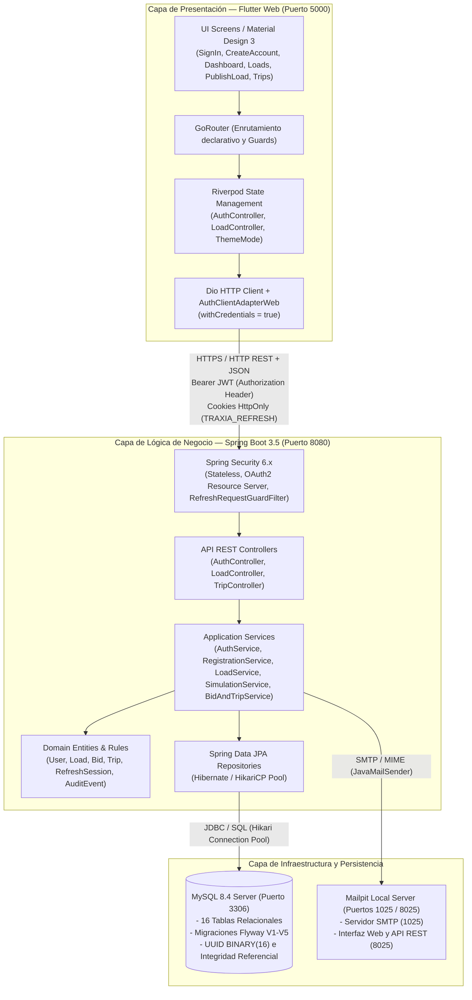

# ARQUITECTURA COMPLETA DEL SISTEMA TRAXIA

## 1. VISIÓN GENERAL DE LA ARQUITECTURA

TRAXIA está estructurado bajo un modelo de arquitectura distribuida en tres capas principales (*3-Tier Architecture*), complementada con principios de diseño de **Arquitectura Limpia (Clean Architecture)** y **Puertos y Adaptadores (Hexagonal Architecture)** en el backend, y un patrón de gestión de estado reactivo y unidireccional en el frontend.

### Diagrama General del Sistema



---

## 2. ARQUITECTURA DEL BACKEND (SPRING BOOT)

El backend de TRAXIA está desacoplado en paquetes orientados al dominio (*Domain-Driven Design* simplificado):

```
backend/src/main/java/com/traxia/
├── TraxiaApplication.java          # Punto de entrada de la aplicación Spring Boot
├── common/                         # Componentes transversales
│   ├── audit/                      # Servicio y entidad de auditoría inmutable
│   └── security/                   # Configuración de seguridad, filtros, JWT y Rate Limiter
├── identity/                       # Módulo de Identidad, Autenticación y Cuentas
│   ├── api/                        # Controladores REST, DTOs y Manejador de Excepciones
│   ├── application/                # Casos de uso: Login, Registro, Refresco, Google Auth
│   ├── domain/                     # Entidades JPA (User, Role, AuthMethod, Token, Session)
│   └── persistence/                # Interfaces de repositorio Spring Data JPA
└── loads/                          # Módulo de Cargas, Subastas, Simulación y Viajes
    ├── api/                        # Controladores de Cargas y Viajes, DTOs
    ├── application/                # Servicios de negocio: LoadService, SimulationService, BidAndTripService
    ├── domain/                     # Entidades JPA: LoadEntity, BidEntity, TripEntity
    └── persistence/                # Repositorios: LoadRepository, BidRepository, TripRepository
```

### Principios Arquitectónicos Aplicados en el Backend

1. **Inversión de Dependencias (DIP):** Los servicios de aplicación dependen de interfaces de repositorio (`UserRepository`, `LoadRepository`), permitiendo desacoplar la lógica de negocio de la implementación tecnológica de base de datos.
2. **Inmutabilidad y Validación Temprana:** Se utilizan Java Records modernos (`CreateLoadRequest`, `RegisterRequest`, `LoginRequest`) con validaciones de `jakarta.validation` (`@NotNull`, `@NotBlank`, `@Size`, `@DecimalMin`), garantizando que ninguna solicitud corrupta llegue a los servicios de dominio.
3. **Manejo Centralizado de Errores (RFC 7807):** A través de `@RestControllerAdvice` (`AuthExceptionHandler`), todas las excepciones se transforman en respuestas estructuradas en formato Problem Details con códigos HTTP estándar (400, 401, 403, 404, 409, 429).
4. **Delimitación Transaccional (@Transactional):** Las operaciones de cambio de estado (como aceptar una oferta, que debe rechazar las demás y crear un viaje simultáneamente) se ejecutan dentro de transacciones ACID aisladas con Hibernate.

---

## 3. ARQUITECTURA DEL FRONTEND (FLUTTER WEB)

El frontend de TRAXIA está desarrollado en Flutter Web utilizando el lenguaje Dart, estructurado en módulos bajo un flujo unidireccional de datos:

```
web/lib/
├── main.dart                       # Inicialización con ProviderScope de Riverpod
├── app.dart                        # Configuración de GoRouter, Temas y ciclo de vida
├── auth/                           # Lógica de autenticación
│   ├── auth_api.dart               # Cliente Dio para endpoints de identidad
│   ├── auth_client_adapter_web.dart# Adaptador web con soporte de credenciales y cookies
│   ├── auth_controller.dart        # ChangeNotifier / Riverpod state controller
│   ├── auth_models.dart            # Modelos inmutables de autenticación
│   └── google_auth_client.dart     # Interoperabilidad con Google Identity Services (GIS)
├── loads/                          # Modelos y clientes de cargas y viajes
│   ├── load_api.dart               # Consumo de endpoints de cargas
│   ├── trips_api.dart              # Consumo de endpoints de viajes
│   ├── load_models.dart            # Modelos de publicación y consulta
│   └── bids_trips_models.dart      # Modelos de ofertas y viajes
├── screens/                        # Pantallas responsivas de la aplicación
│   ├── sign_in_screen.dart         # Pantalla de Login (split screen responsiva)
│   ├── create_account_screen.dart  # Pantalla de Registro con selector de perfil
│   ├── verify_email_screen.dart    # Pantalla de verificación de correo con token
│   ├── dashboard_screen.dart       # Consola principal con KPIs y accesos directos
│   ├── loads_screen.dart           # Cartelera de cargas y simulación
│   ├── publish_load_screen.dart    # Asistente de publicación en 5 etapas
│   └── trips_screen.dart           # Seguimiento y gestión de viajes
├── state/                          # Definición de Providers globales de Riverpod
├── theme/                          # Definición del sistema de diseño (AppColors, AppTheme)
└── widgets/                        # Componentes reutilizables (NavBar, Toggles, Modales)
```

### Características Clave del Frontend

- **Riverpod (Gestión de Estado):** Desacoplamiento total entre los widgets visuales y la lógica de estado. El estado de sesión (`authControllerProvider`) se propaga reactivamente a toda la aplicación.
- **GoRouter con Guards de Navegación:** El enrutador intercepta cada transición de URL. Si el usuario intenta acceder a rutas privadas (`/panel`, `/publicar-carga`, `/viajes`) sin autenticación, es redirigido a `/iniciar-sesion`. Si ya está autenticado e intenta ir a `/iniciar-sesion`, es redirigido a `/panel`.
- **Adaptador Web Condicional:** Uso de compilación condicional (`if (dart.library.js_interop)`) para configurar `BrowserHttpClientAdapter()..withCredentials = true`, garantizando que el navegador adjunte y reciba cookies HttpOnly de sesión sin violar políticas del navegador.

---

## 4. FLUJO DE DATOS END-TO-END

### Caso de Uso: Ciclo de Autenticación y Consulta

```mermaid
sequenceDiagram
    autonumber
    actor User as Usuario / Navegador
    participant Flutter as Flutter Web (Port 5000)
    participant SpringSec as Spring Security (Port 8080)
    participant AuthSvc as AuthService
    participant MySQL as MySQL 8.4 Server

    User->>Flutter: Ingresa credenciales (email, password)
    Flutter->>SpringSec: POST /api/v1/auth/login
    SpringSec->>AuthSvc: Validar credenciales
    AuthSvc->>MySQL: Consultar usuario y hash BCrypt
    MySQL--AuthSvc: Retorna UserEntity + AuthMethod
    AuthSvc->>AuthSvc: BCrypt.checkpw() -> OK
    AuthSvc->>AuthSvc: Generar JWT Access Token (10 min)
    AuthSvc->>MySQL: Guardar Refresh Session (Hash SHA-256)
    AuthSvc--SpringSec: Retorna Tokens
    SpringSec--Flutter: HTTP 200 OK + JWT (Body) + Set-Cookie (TRAXIA_REFRESH, HttpOnly)
    Flutter->>User: Almacena JWT en memoria y redirige a /panel

    Note over Flutter, SpringSec: Petición a recurso protegido
    User->>Flutter: Navega a /cargas
    Flutter->>SpringSec: GET /api/v1/loads (Authorization: Bearer <JWT>)
    SpringSec->>SpringSec: Validar firma JWT y expiración
    SpringSec--Flutter: HTTP 200 OK + List<LoadResponse>
    Flutter->>User: Renderiza Cartelera de Cargas
```

---

## 5. INFRAESTRUCTURA Y SERVICIOS AUXILIARES

1. **MySQL 8.4 Server:**
   - Base de datos relacional transaccional.
   - Motor de almacenamiento: `InnoDB`.
   - Conjunto de caracteres: `utf8mb4` con colación `utf8mb4_0900_ai_ci` para soporte internacional de texto, acentos y caracteres especiales.
   - Versionamiento del esquema automatizado mediante **Flyway Migrations** (scripts V1 a V5).
2. **Mailpit:**
   - Servidor local de emulación SMTP (puerto 1025) con consola de inspección web y API REST (puerto 8025).
   - Captura todos los correos electrónicos salientes de verificación sin requerir credenciales externas ni conectividad externa.
