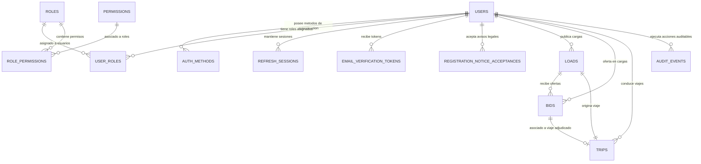

# AUDITORÍA DE BASE DE DATOS: MYSQL 8.4 Y FLYWAY

## 1. VISIÓN GENERAL DEL MODELO DE DATOS

La persistencia del proyecto TRAXIA está construida sobre **MySQL 8.4 Community Server**, utilizando el motor de almacenamiento transaccional **InnoDB** con codificación `utf8mb4` y colación `utf8mb4_0900_ai_ci`.

El esquema se encuentra 100% versionado y gobernado mediante **Flyway Database Migrations**, garantizando despliegues repetibles, trazabilidad histórica y cero intervención manual directa sobre el esquema físico.

---

## 2. INVENTARIO Y DESCRIPCIÓN DE TABLAS

La base de datos `traxia` contiene un total de **16 tablas**:

### A. Módulo de Identidad y Roles (Migración V1)
1. **`users`:** Tabla central de identidades.
   - `id`: `BIGINT AUTO_INCREMENT` (Clave primaria interna).
   - `public_id`: `BINARY(16) NOT NULL UNIQUE` (Identificador público expuesto en la API REST).
   - `email_normalized`: `VARCHAR(254) NOT NULL UNIQUE` (Correo en minúsculas y sin espacios).
   - `status`: `VARCHAR(32) NOT NULL` (`PENDING_VERIFICATION`, `ACTIVE`, `BLOCKED`, `REVOKED`).
   - `email_verified_at_utc`: `DATETIME(6) NULL` (Estampa temporal UTC de verificación).
   - `version`: `BIGINT NOT NULL DEFAULT 0` (Control de concurrencia optimista de JPA `@Version`).
   - `created_at_utc`, `updated_at_utc`: `DATETIME(6) NOT NULL`.
2. **`roles`:** Catálogo de roles globales (`SHIPPER`, `DRIVER`, `CARRIER`, `ADMIN`).
3. **`permissions`:** Catálogo de permisos específicos del sistema.
4. **`user_roles`:** Relación muchos a muchos con histórico de asignación (`assigned_at_utc`, `revoked_at_utc`).
5. **`role_permissions`:** Matriz de asociación entre roles y permisos.
6. **`auth_methods`:** Credenciales asociadas al usuario (`EMAIL`, `PASSWORD`, `GOOGLE`). Guarda el hash BCrypt (`credential_hash`).
7. **`refresh_sessions`:** Registro de tokens de refresco activos e históricos.
   - `family_id`: `BINARY(16)` (Agrupa las rotaciones de una misma sesión para revocación en cadena).
   - `token_hash`: `CHAR(64)` (Resumen SHA-256 del token, nunca texto plano).
   - `replaced_by_id`: Clave foránea reflexiva que apunta a la sesión que la reemplazó.
8. **`audit_events`:** Registro inmutable de eventos de auditoría (`action_code`, `entity_type`, `outcome`, `occurred_at_utc`).

### B. Módulo de Limitación de Intentos (Migración V2)
9. **`auth_attempt_limits`:**
   - `bucket_hash`: `BINARY(32)` Clave primaria (HMAC-SHA256 del correo o IP).
   - `failure_count`: Contador de fallos acumulados en la ventana de tiempo.
   - `blocked_until_utc`: Estampa temporal hasta la cual se deniega el acceso.

### C. Módulo de Registro y Activación Local (Migración V3)
10. **`registration_notice_acceptances`:** Constancia legal de aceptación de avisos de privacidad y condiciones de prueba.
11. **`email_verification_tokens`:** Tokens temporales para validación de correo.
    - `token_hash`: `CHAR(64) UNIQUE` (Hash SHA-256).
    - `expires_at_utc`: Fecha de expiración (30 minutos por defecto).
    - `consumed_at_utc`: Estampa de consumo (impide reutilización).

### D. Módulo de Cargas y Mercancías (Migración V4)
12. **`loads`:** Registro completo de fletes publicados.
    - `publisher_user_id`: FK a `users(id)`.
    - `status`: `VARCHAR(32)` (`PUBLISHED`, `ASSIGNED`, `IN_TRANSIT`, `DELIVERED`, `CANCELLED`).
    - `origin_department`, `origin_city`, `origin_address`.
    - `destination_department`, `destination_city`, `destination_address`.
    - `pickup_date_utc`, `delivery_date_utc`.
    - `product_type`, `weight_kg` (`DECIMAL(10,2)`), `volume_m3` (`DECIMAL(10,2)`).
    - `packaging_type`, `requires_refrigeration` (`BOOLEAN`).
    - `vehicle_type`, `body_type`, `pricingType`, `offered_price` (`DECIMAL(12,2)`), `payer`.

### E. Módulo de Subastas y Viajes (Migración V5)
13. **`bids`:** Ofertas económicas de transportistas.
    - `load_id`: FK a `loads(id)`.
    - `bidder_user_id`: FK a `users(id)`.
    - `offered_amount`: `DECIMAL(12,2)`.
    - `status`: `PENDING`, `ACCEPTED`, `REJECTED`, `WITHDRAWN`.
14. **`trips`:** Contratos de transporte y ejecución física de viaje.
    - `load_id`: FK a `loads(id)` (Restricción `UNIQUE` para asegurar que cada carga tenga máximo un viaje activo).
    - `bid_id`: FK a `bids(id)` (Oferta ganadora).
    - `driver_user_id`: FK a `users(id)` (Conductor asignado).
    - `agreed_amount`: `DECIMAL(12,2)` (Monto cerrado del flete).
    - `status`: `ASSIGNED`, `IN_TRANSIT`, `DELIVERED`, `CANCELLED`.
    - `started_at_utc`, `delivered_at_utc`, `delivery_proof_notes`.

### F. Control de Migraciones
15. **`flyway_schema_history`:** Registro de migraciones aplicadas con suma de verificación SHA-256 (*checksum*).

---

## 3. DECISIONES DE DISEÑO Y PATRONES DE BASE DE DATOS

### Clave Subrogada vs. Clave Pública UUID (BINARY(16))
TRAXIA implementa un patrón de doble identificación (*Dual Identifier Pattern*):
- **Clave Primaria Interna (`id BIGINT AUTO_INCREMENT`):** Se utiliza exclusivamente para las relaciones internas y claves foráneas en la base de datos. Los enteros de 64 bits garantizan inserciones monótonas en el índice primario en árbol B+ de InnoDB sin fragmentación de páginas.
- **Identificador Público (`public_id BINARY(16)`):** Se expone al exterior en las APIs REST como un UUID estándar de 36 caracteres (ej. `6b559aac-cb96-4847-8e0e-1f9f5e7979d4`). Almacenarlo físicamente en 16 bytes reduce a la mitad el tamaño del índice y protege al sistema contra ataques de enumeración secuencial.

### Integridad Referencial y Restricciones
- Todas las claves foráneas tienen restricciones explícitas `ON DELETE RESTRICT` o predeterminadas en InnoDB, impidiendo borrados accidentales en cascada de datos operativos o de auditoría.
- La unicidad de ofertas activas y relaciones de viaje está resguardada por índices únicos (`uk_trips_load`, `uk_bids_public_id`, `uk_loads_public_id`).

### Transacciones y Aislamiento ACID
- Las operaciones críticas de cambio de estado (como la aceptación de una oferta en `BidAndTripService.acceptBid`) se ejecutan bajo la anotación `@Transactional` de Spring Framework.
- Dentro de la misma transacción física en MySQL:
  1. Se bloquea la oferta seleccionada y se valida que la carga siga `PUBLISHED`.
  2. Se cambia el estado de la oferta a `ACCEPTED`.
  3. Se cambia el estado de la carga a `ASSIGNED`.
  4. Se actualizan todas las demás ofertas abiertas a `REJECTED`.
  5. Se inserta el nuevo viaje en `trips`.
  6. Se insertan los registros de auditoría en `audit_events`.
- Si cualquiera de estas instrucciones falla, el motor InnoDB realiza un `ROLLBACK` completo, garantizando que jamás existan estados inconsistentes.

---

## 4. HISTORIAL DE MIGRACIONES FLYWAY

| Versión | Descripción | Archivo de Script | Checksum de Ejecución | Estado |
|---|---|---|---|---|
| **1** | identity and sessions | `V1__identity_and_sessions.sql` | `908868995` | **Success (1)** |
| **2** | authentication attempt limits | `V2__authentication_attempt_limits.sql` | `1026046162` | **Success (1)** |
| **3** | local self service registration | `V3__local_self_service_registration.sql` | `269387402` | **Success (1)** |
| **4** | loads and cargo | `V4__loads_and_cargo.sql` | `-129658532` | **Success (1)** |
| **5** | bids and trips | `V5__bids_and_trips.sql` | `984288015` | **Success (1)** |

Todas las migraciones se encuentran aplicadas con éxito en el servidor local de MySQL 8.4.
