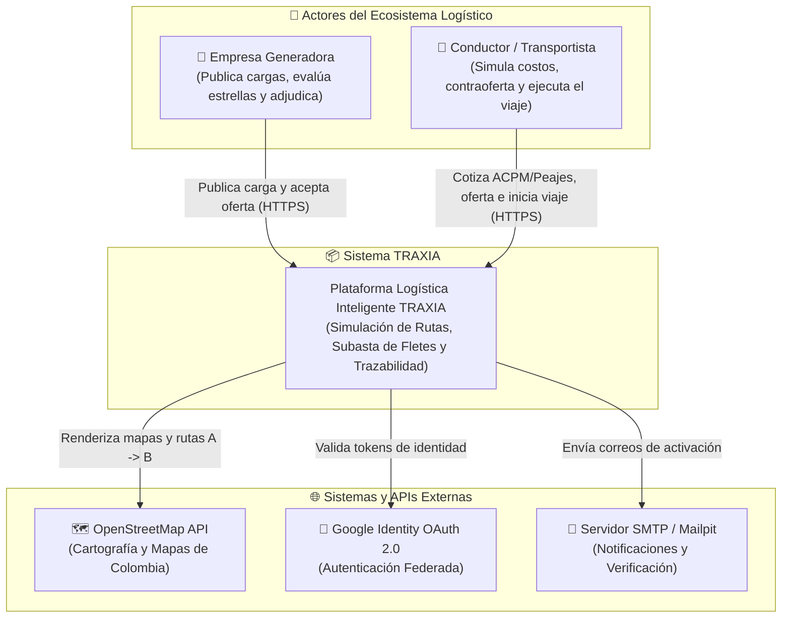
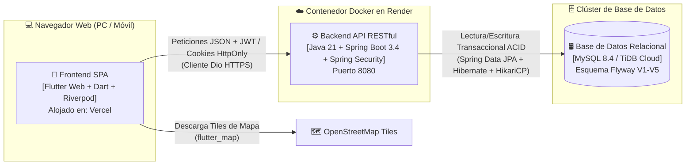
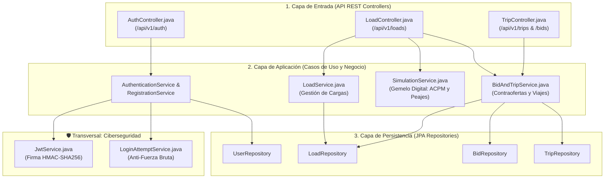
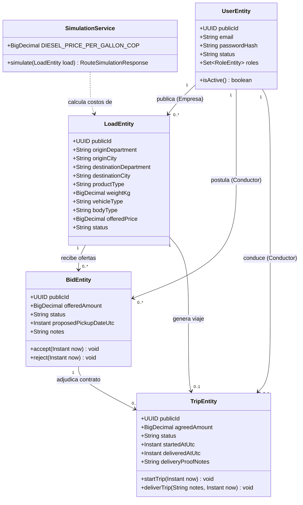
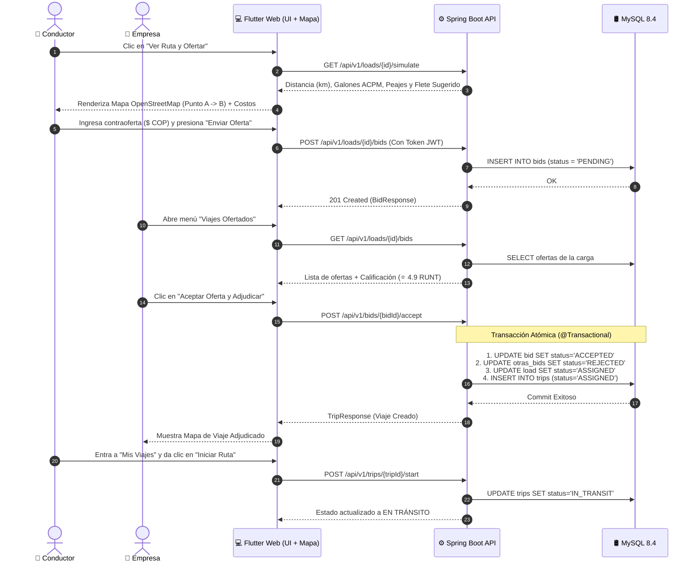
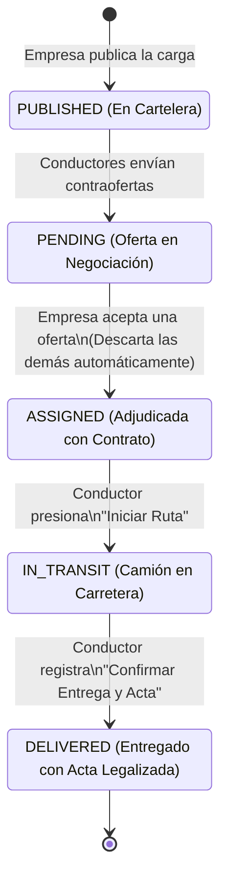
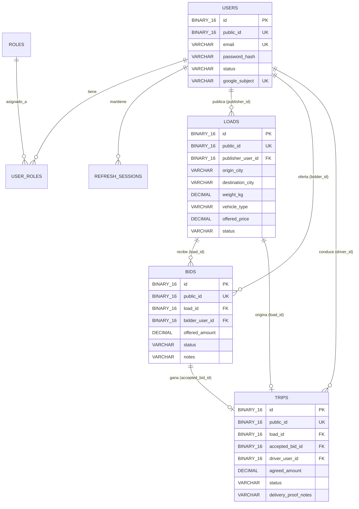

# 📘 Manual Oficial de Ingeniería de Software — Proyecto TRAXIA (Especial Feria y Sustentación)

Este documento reúne todas las respuestas técnicas, modelos de ingeniería, **Modelo C4** y **Diagramas UML** exigidos por los jurados en la feria de Ingeniería de Sistemas / Software, explicados en lenguaje claro para estudiar y defender con **5.0**.

---

## 1. ¿Qué Arquitectura de Software se usó?

En **TRAXIA** implementamos una combinación de **3 niveles arquitectónicos**:

1. **A nivel Macro (Infraestructura): Arquitectura Cliente-Servidor Desacoplada vía API RESTful en la Nube.**
   * El **Cliente (Frontend)** vive en **Vercel** y se comunica por protocolo HTTPS intercambiando archivos JSON con el **Servidor (Backend)** que vive en **Render**. Están 100% separados: si el diseño visual cambia, el servidor no se entera.
2. **A nivel Interno del Backend: Monolito Modular guiado por DDD (Domain-Driven Design) + Clean Architecture (Arquitectura Limpia / Hexagonal).**
   * **¿Qué es un Monolito Modular?** En lugar de tener 10 microservicios costosos y difíciles de mantener, tenemos un solo servidor en Java pero **dividido internamente en módulos independientes** (`identity` para seguridad/usuarios y `loads` para cargas/ofertas/viajes).
   * **¿Qué es Clean Architecture (Arquitectura en Capas)?** Cada módulo se divide en 4 capas concéntricas para no revolver código:
     * **`api` (Controladores REST):** Recibe las peticiones de internet (ej. [`LoadController.java`](file:///C:/Users/marti/Downloads/traxia-main/traxia-main/backend/src/main/java/com/traxia/loads/api/LoadController.java)).
     * **`application` (Casos de Uso):** Coordina el flujo del negocio (ej. [`BidAndTripService.java`](file:///C:/Users/marti/Downloads/traxia-main/traxia-main/backend/src/main/java/com/traxia/loads/application/BidAndTripService.java)).
     * **`domain` (Entidades y Reglas Puras):** El corazón que protege las leyes del transporte (ej. [`LoadEntity.java`](file:///C:/Users/marti/Downloads/traxia-main/traxia-main/backend/src/main/java/com/traxia/loads/domain/LoadEntity.java), [`TripEntity.java`](file:///C:/Users/marti/Downloads/traxia-main/traxia-main/backend/src/main/java/com/traxia/loads/domain/TripEntity.java)).
     * **`persistence` (Repositorios SQL):** Habla con MySQL mediante Spring Data JPA (ej. [`LoadRepository.java`](file:///C:/Users/marti/Downloads/traxia-main/traxia-main/backend/src/main/java/com/traxia/loads/persistence/LoadRepository.java)).
3. **A nivel Interno del Frontend: Arquitectura Reactiva basada en Estado (MVVM / Provider Pattern con Riverpod).**

---

## 2. ¿Qué Metodología de Desarrollo se usó?

Utilizamos una **Metodología Ágil Híbrida (Scrum Adaptado + XP / Extreme Programming)** organizada en **5 Sprints incrementales** (que coinciden exactamente con nuestras 5 migraciones `V1` a `V5`):

* **Sprint 1:** Núcleo de Identidad, Seguridad JWT y Sesiones (`V1`).
* **Sprint 2:** Ciberseguridad, Rate Limiting y Protección contra Fuerza Bruta (`V2`).
* **Sprint 3:** Registro Local, Términos Legales y Verificación de Correo con Mailpit (`V3`).
* **Sprint 4:** Integración de Identidad Federada con Google OAuth 2.0 (`V4`).
* **Sprint 5:** Marketplace de Cargas, Gemelo Digital de Costos, Mapa OpenStreetMap, Contraofertas y Ejecución de Viajes (`V5`).

**Prácticas de Ingeniería Aplicadas:**
* **Control de Versiones con Git & GitHub:** Flujo basado en ramas (`main` para producción en Vercel/Render y ramas de características como `Cambios_Importantes_Traxia`).
* **CI/CD (Integración y Despliegue Continuo):** Cada `git push` a la rama `main` dispara automáticamente el despliegue del Frontend en Vercel y del contenedor Docker del Backend en Render.

---

## 3. ¿Base de Datos Relacional o No Relacional? (Pregunta Fija de Jurado)

> [!IMPORTANT]
> **Respuesta corta y contundente:** Usamos una **Base de Datos RELACIONAL (SQL)** con **MySQL 8.4** (y compatible con **TiDB Cloud** en producción).

### ¿Por qué elegimos Relacional (SQL) y NO una No-Relacional (como MongoDB)?
Por **3 razones de ingeniería financiera y contractual**:
1. **Propiedades ACID (Transaccionalidad Atómica):** Cuando una empresa acepta la oferta de un conductor, deben ocurrir **3 cosas al mismo tiempo sin fallar**:
   * La oferta elegida pasa a `ACCEPTED`.
   * Las demás ofertas competidoras pasan a `REJECTED`.
   * La carga pasa a `ASSIGNED` y nace el contrato del viaje (`trips`).
   En una base de datos Relacional SQL con `@Transactional`, o se hacen las 3 cosas juntas o no se hace ninguna (*Rollback*). Así **nunca dos camioneros pueden quedar contratados para la misma carga por error**.
2. **Integridad Referencial (Llaves Foráneas `FOREIGN KEY`):** No puede existir un viaje huérfano sin carga, ni una oferta sin un usuario real registrado en la tabla `users`.
3. **Optimización de Almacenamiento:** Usamos claves primarias e identificadores públicos en formato binario **`BINARY(16)`** en vez de texto (`VARCHAR(36)`), reduciendo el peso de los índices en más de un **55% en memoria RAM**.

---

## 4. ¿Qué APIs Consumimos y Qué APIs Exponemos?

Es fundamental distinguir ante el jurado entre **APIs de terceros que consumimos** y **nuestra propia API que creamos**:

### A. APIs Externas que TRAXIA Consume (Clientes)
1. **API de OpenStreetMap Tile Server (`https://tile.openstreetmap.org/{z}/{x}/{y}.png`):**
   * **Para qué sirve:** Descarga en tiempo real los cuadrantes cartográficos vectoriales del mapa de Colombia en [`colombia_route_map.dart`](file:///C:/Users/marti/Downloads/traxia-main/traxia-main/web/lib/widgets/colombia_route_map.dart) para pintar los pines del Punto A (Origen), Punto B (Destino) y la trayectoria roja punteada.
2. **API de Google Identity Services / OAuth 2.0 (`googleapis.com`):**
   * **Para qué sirve:** Permite autenticar usuarios con su cuenta de Google validando criptográficamente el `idToken` emitido por Google en el backend.
3. **Servicio SMTP / Mailpit API:**
   * **Para qué sirve:** Envío de correos transaccionales de verificación de cuenta.

### B. API Propia que TRAXIA Expone (Servidor RESTful Propio)
Nuestro backend en Spring Boot expone **14 endpoints RESTful** bajo el prefijo `/api/v1/`:
* **Módulo Auth (`/api/v1/auth`):** `/login`, `/register`, `/google`, `/refresh`, `/logout`, `/me`, `/verify-email`.
* **Módulo Cargas (`/api/v1/loads`):** `POST /loads` (publicar), `GET /loads` (buscar), `GET /loads/my` (mis cargas), `GET /loads/{id}/simulate` (Gemelo Digital de costos ACPM/peajes), `POST /loads/{id}/bids` (contraofertar), `GET /loads/{id}/bids` (ver ofertas).
* **Módulo Viajes (`/api/v1/bids` y `/api/v1/trips`):** `GET /bids/my`, `POST /bids/{id}/accept`, `GET /trips/my`, `POST /trips/{id}/start`, `POST /trips/{id}/deliver`.

---

## 5. Modelo C4 de Arquitectura de Software

El **Modelo C4** (creado por Simon Brown) es el estándar moderno para explicar arquitecturas haciendo "zoom" como en un mapa (Nivel 1: Contexto, Nivel 2: Contenedores, Nivel 3: Componentes).

### Nivel C1: Diagrama de Contexto del Sistema (Visión General)
Muestra quiénes usan TRAXIA y con qué sistemas externos se conecta:

---

### Nivel C2: Diagrama de Contenedores (Tecnologías y Despliegue)
Hace "zoom" dentro de TRAXIA para mostrar el Frontend, el Backend y la Base de Datos:

---

### Nivel C3: Diagrama de Componentes del Backend (Clean Architecture)
Hace "zoom" dentro del servidor Spring Boot para mostrar cómo interactúan los archivos Java:

---

## 6. Diagramas UML de Ingeniería de Software

### A. Diagrama UML de Clases de Dominio
Representa las entidades principales del código y qué datos/operaciones tiene cada una:

---

### B. Diagrama UML de Secuencia (Flujo Completo de Contraoferta y Adjudicación)
Explica paso a paso cómo conversan el Conductor, la Empresa, Flutter, Spring Boot y MySQL:

---

### C. Diagrama UML de Máquina de Estados (Ciclo de Vida de Carga y Viaje)
Muestra cómo evoluciona una carga desde que nace hasta que el camión entrega la mercancía:

---

## 7. Modelo Entidad-Relación (MER / Base de Datos Relacional)

Este es el esquema exacto de tablas creado por Flyway (`V1` a `V5`):

---

## 8. Diseño de Ingeniería: Patrones de Diseño y Norma ISO/IEC 25010

Si en la feria un profesor pregunta por el **Diseño de Ingeniería** o **Patrones de Diseño**, menciona estos 5 que están en el código:

1. **Patrón Repository (Repositorio):** Aísla las consultas SQL de la lógica de negocio (`LoadRepository`, `TripRepository`).
2. **Patrón DTO (Data Transfer Object):** Nunca enviamos la tabla cruda de la base de datos por internet (porque expondríamos datos sensibles). Usamos objetos limpios llamados `LoadResponse`, `BidResponse` y `TripResponse` (definidos con `record` de Java 21 en [`BidDtos.java`](file:///C:/Users/marti/Downloads/traxia-main/traxia-main/backend/src/main/java/com/traxia/loads/api/BidDtos.java)).
3. **Patrón Factory Method (Método Fábrica):** Por ejemplo `TripEntity.createFromBid(load, bid, now)` para construir un viaje garantizando que herede el monto exacto de la oferta aceptada.
4. **Patrón Inyección de Dependencias (IoC):** Spring Boot inyecta los servicios por constructor, facilitando las pruebas unitarias con JUnit 5 y Mockito.
5. **Patrón Observer / Estado Reactivo:** Usado en Flutter con `Riverpod` (`StateNotifier` / `ChangeNotifier`) para que la barra de navegación y las pantallas se actualicen automáticamente cuando el usuario inicia o cierra sesión.
