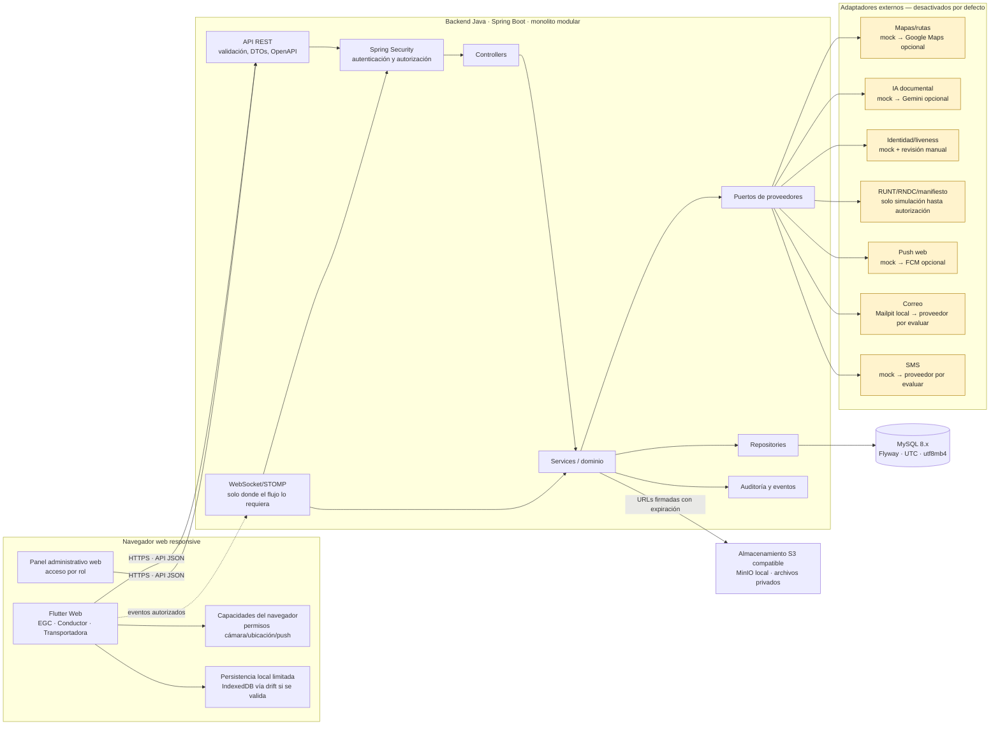

# Diagrama 01 — Arquitectura general

## Principios de lectura

- El navegador nunca se conecta directamente a MySQL ni al almacenamiento privado.
- Toda regla de autorización y negocio vive en el servidor; ocultar una acción en la UI no sustituye autorización.
- Los mocks tienen etiqueta visible y no producen trámites, tarifas ni verificaciones oficiales.
- Las acciones offline se almacenan como pendientes locales; contratación, verificación final y confirmación legal requieren servidor.
- La geolocalización en web depende de permiso, contexto seguro y disponibilidad del navegador. No se promete seguimiento permanente en segundo plano.
- Los adaptadores reales se mantienen apagados por defecto. Se revisan costo, condiciones y consentimiento antes de activarlos.
