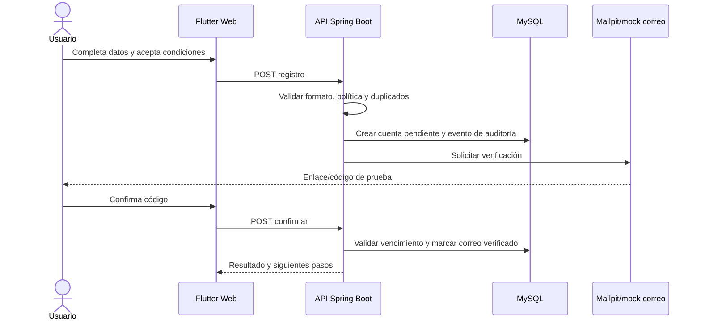
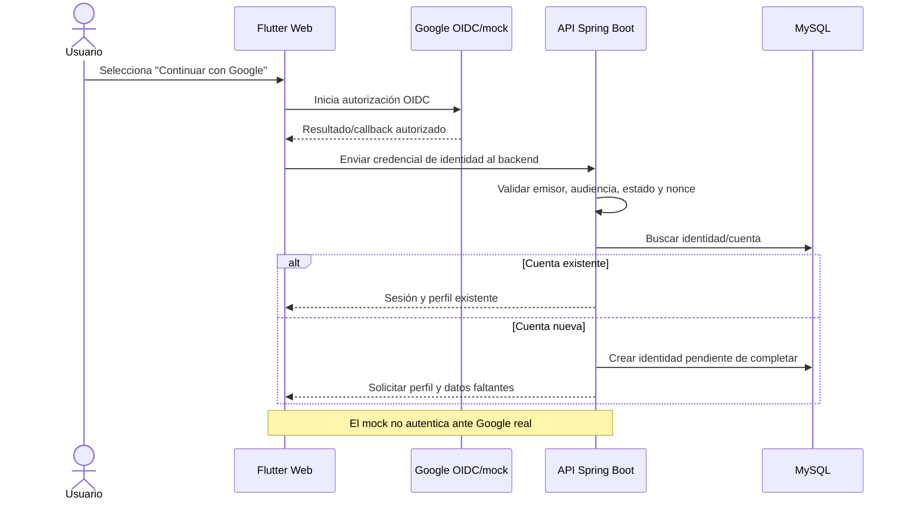
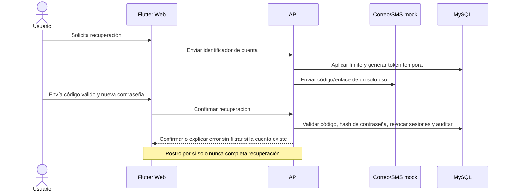
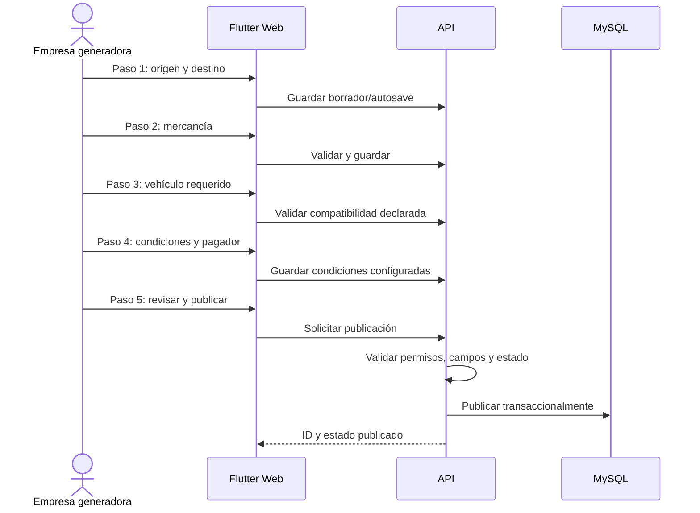
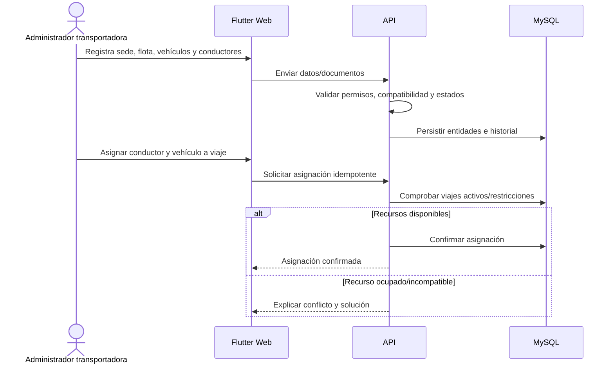
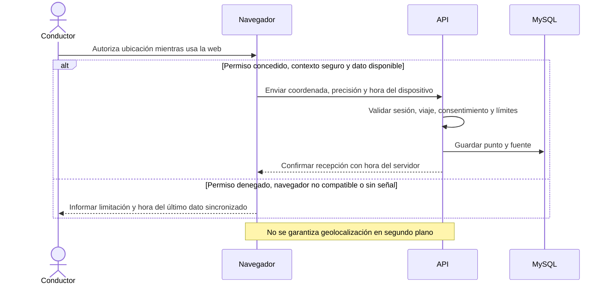
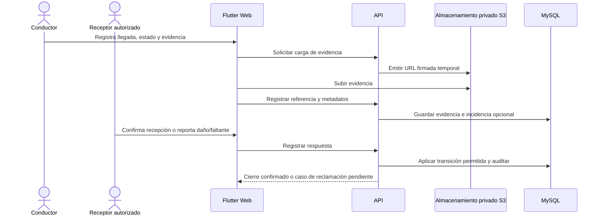

# Diagramas 02 — Secuencias de flujos clave

Los actores usan el navegador responsive. Las alternativas de proveedor se muestran como puertos con mocks. Ningún flujo de mock constituye aprobación oficial.

## 02.1 Registro con correo



## 02.2 Registro con Google



## 02.3 Vinculación de cuentas

```mermaid
sequenceDiagram
    actor U as Usuario autenticado
    participant W as Flutter Web
    participant A as API
    participant G as Proveedor OIDC
    participant D as MySQL
    U->>W: Solicita vincular Google/correo
    W->>A: Solicitar paso de reautenticación
    A-->>W: Instrucciones de verificación
    W->>G: Autenticar identidad secundaria
    G-->>W: Identidad verificada
    W->>A: Enviar prueba de vinculación
    A->>D: Comprobar que identidad no esté asociada a otra cuenta
    alt Identidad disponible
        A->>D: Vincular método y auditar
        A-->>W: Vinculación confirmada
    else Ya pertenece a otra cuenta
        A-->>W: Rechazar; indicar recuperación segura
    end
```

## 02.4 Verificación facial web (mock inicial)

```mermaid
sequenceDiagram
    actor U as Usuario
    participant W as Navegador/Flutter Web
    participant A as API
    participant V as Puerto de identidad
    participant H as Administrador revisor
    U->>W: Lee finalidad y decide consentimiento
    alt Consentimiento otorgado
        W->>W: Solicitar cámara; comprobar permiso/disponibilidad
        W->>A: Iniciar verificación y consentimiento
        A->>V: Crear sesión de prueba sin enviar datos al LLM
        V-->>A: Resultado mock "pendiente de revisión"
        A-->>W: Mostrar simulación/estado pendiente
        H->>A: Revisar manualmente
        A-->>W: Notificar decisión y motivo
    else Sin consentimiento o cámara no disponible
        W-->>U: Ofrecer alternativa manual; no capturar biometría
    end
    Note over U,V: Mock no prueba identidad real ni reemplaza revisión humana
```

## 02.5 Recuperación de cuenta



## 02.6 Publicación de carga (cinco pasos)



## 02.7 Oferta y contratación con concurrencia

```mermaid
sequenceDiagram
    actor C as Conductor/transportadora
    actor E as Empresa
    participant W as Flutter Web
    participant A as API
    participant D as MySQL
    C->>W: Envía oferta
    W->>A: Crear oferta idempotente
    A->>D: Guardar oferta e historial
    A-->>E: Notificar oferta recibida
    E->>W: Selecciona oferta y confirma condiciones
    W->>A: Confirmación de contratación
    A->>D: Transacción + bloqueo/versión + restricciones únicas
    alt Aceptación válida y primera
        D-->>A: Reservar carga/conductor/vehículo
        A-->>W: Contrato confirmado; revelar contacto permitido
    else Doble aceptación o estado cambió
        D-->>A: Conflicto
        A-->>W: Informar que ya no está disponible
    end
```

## 02.8 Gestión de empresa transportadora



## 02.9 Seguimiento desde navegador



## 02.10 Entrega y cierre


