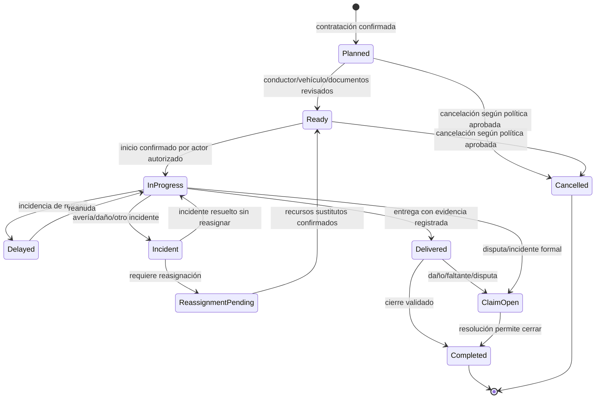
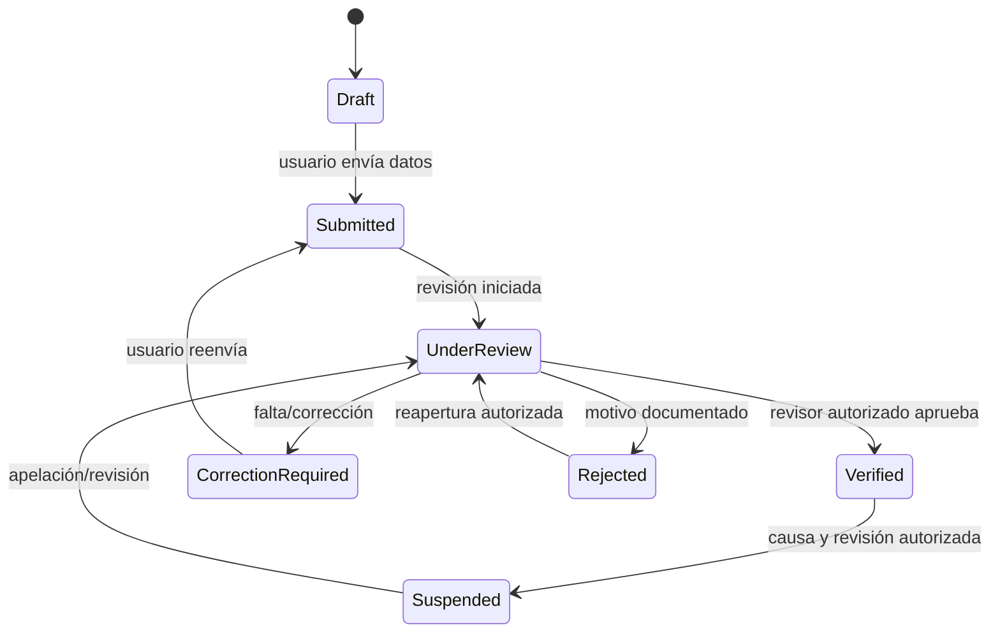
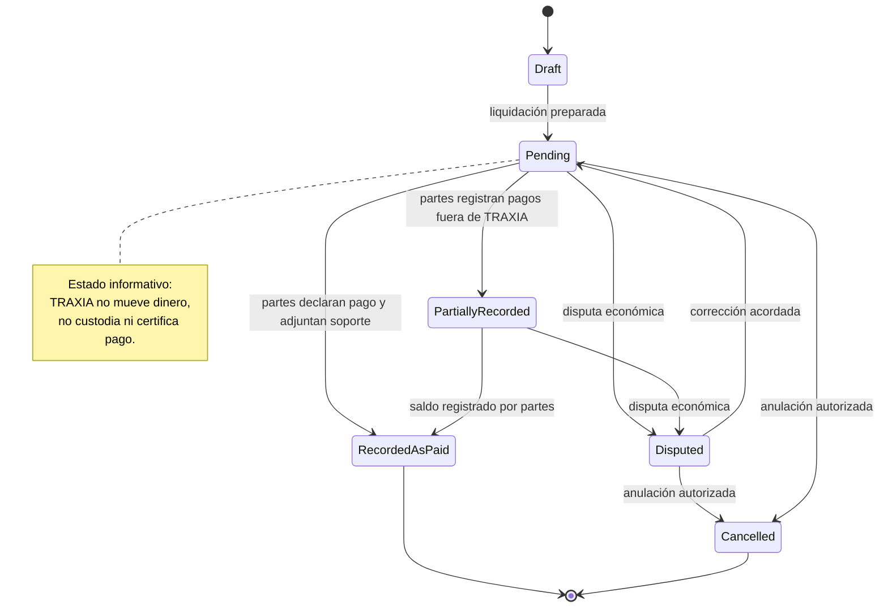
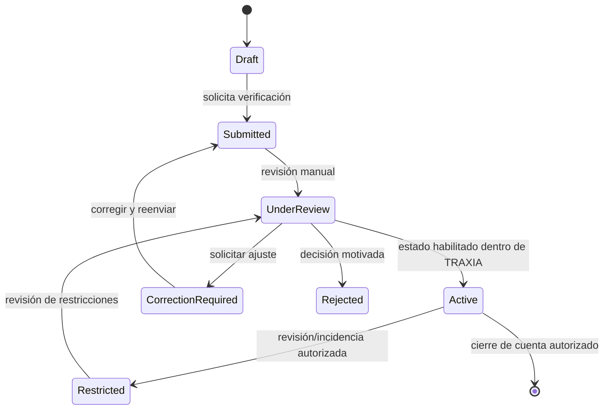
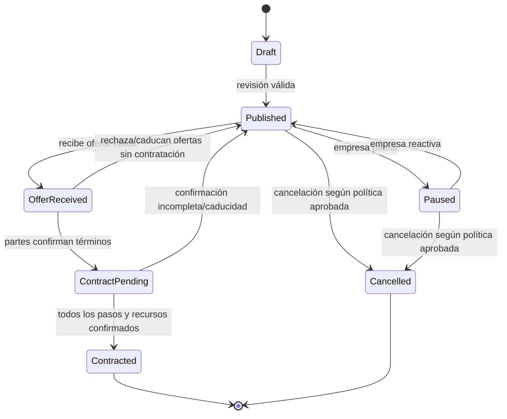

# Diagramas 03 — Máquinas de estados

Las transiciones son conceptuales y se deben refinar con reglas de negocio antes del modelo físico. Una transición no autorizada debe fallar sin alterar el estado.

## 03.1 Viaje

## 03.2 Verificación de cuenta

## 03.3 Pago informativo/liquidación (sin custodia)

## 03.4 Gestión de transportadora

## 03.5 Carga publicada

## Invariantes a probar

- `Contracted` requiere secuencia de confirmaciones y una asignación única.
- Un conductor/vehículo no puede tener dos viajes activos simultáneos.
- `Completed` exige entrega/evidencia o excepción aprobada con auditoría.
- La calificación exige viaje `Completed`.
- Las transiciones de cancelación respetan política configurable aún pendiente de aprobación; no se inventan penalidades.
- Los estados informativos de liquidación no equivalen a pago procesado por TRAXIA.
