# Diagrama 04 — Modelo de dominio y ER de alto nivel

El diagrama relaciona las áreas enumeradas en la sección 30 del Documento Maestro y añade las estructuras expresamente pedidas para múltiples vehículos, flotas, sedes y viajes recurrentes. No fija aún tipos, índices ni normalización final.

```mermaid
erDiagram
    USER ||--o{ USER_ROLE : has
    ROLE ||--o{ USER_ROLE : assigned
    ROLE ||--o{ ROLE_PERMISSION : grants
    PERMISSION ||--o{ ROLE_PERMISSION : includes
    USER ||--o{ AUTH_METHOD : accesses_with
    USER ||--o| DRIVER_PROFILE : may_have
    USER ||--o{ COMPANY_MEMBERSHIP : belongs_to
    COMPANY ||--o{ COMPANY_BRANCH : has
    COMPANY ||--o{ COMPANY_MEMBERSHIP : employs
    COMPANY ||--o| CARRIER_PROFILE : may_be
    COMPANY ||--o{ FLEET : manages
    FLEET ||--o{ VEHICLE : contains
    COMPANY_BRANCH ||--o{ VEHICLE : bases
    DRIVER_PROFILE ||--o{ DRIVER_VEHICLE : assigned
    VEHICLE ||--o{ DRIVER_VEHICLE : operated_by
    VEHICLE ||--o{ DOCUMENT : documented_by
    DRIVER_PROFILE ||--o{ DOCUMENT : documented_by
    COMPANY ||--o{ VERIFICATION_REQUEST : requests
    USER ||--o{ VERIFICATION_REQUEST : submits
    VERIFICATION_REQUEST ||--o{ DOCUMENT_REVIEW : reviewed_as
    USER ||--o{ DOCUMENT_REVIEW : reviewer
    COMPANY ||--o{ LOAD : publishes
    LOAD ||--o{ BID : receives
    USER ||--o{ BID : submits
    LOAD ||--o| TRIP : becomes
    TRIP ||--o{ ASSIGNMENT : uses
    DRIVER_PROFILE ||--o{ ASSIGNMENT : assigned
    VEHICLE ||--o{ ASSIGNMENT : assigned
    TRIP ||--o| ROUTE_PLAN : planned
    ROUTE_PLAN ||--o{ ROUTE_STOP : contains
    ROUTE_PLAN ||--o{ SIMULATION : simulated_as
    TRIP ||--o{ LOCATION_POINT : tracked_by
    TRIP ||--o{ INCIDENT : records
    TRIP ||--o{ DELIVERY : closes_with
    DELIVERY ||--o{ FILE_OBJECT : evidenced_by
    TRIP ||--o{ QUOTE : priced_by
    TRIP ||--o{ EXPENSE : incurs
    TRIP ||--o| SETTLEMENT : summarized_by
    TRIP ||--o{ RATING : receives
    TRIP ||--o{ CLAIM : disputed_by
    TRIP ||--o{ CHAT_MESSAGE : communicates
    USER ||--o{ CHAT_MESSAGE : authors
    USER ||--o{ NOTIFICATION : receives
    TRIP ||--o{ BENEFIT_GRANT : may_earn
    BENEFIT ||--o{ BENEFIT_GRANT : granted
    USER ||--o{ AUDIT_EVENT : actor
    TRIP ||--o{ AUDIT_EVENT : related_to
    USER ||--o{ REPORT : requests
    RECURRING_TRIP ||--o{ TRIP : creates_instances

    USER {
        bigint id PK
        uuid public_id UK
        string email
        string status
        datetime created_at_utc
    }
    COMPANY {
        bigint id PK
        uuid public_id UK
        string legal_name
        string company_type
        string verification_status
    }
    COMPANY_BRANCH {
        bigint id PK
        bigint company_id FK
        string name
        string address
    }
    DRIVER_PROFILE {
        bigint id PK
        bigint user_id FK
        string verification_status
    }
    FLEET {
        bigint id PK
        bigint company_id FK
        string name
    }
    VEHICLE {
        bigint id PK
        bigint fleet_id FK
        bigint branch_id FK
        string status
        decimal capacity
    }
    LOAD {
        bigint id PK
        bigint company_id FK
        string state
        datetime published_at_utc
    }
    BID {
        bigint id PK
        bigint load_id FK
        bigint user_id FK
        string state
        decimal proposed_amount
    }
    TRIP {
        bigint id PK
        bigint load_id FK
        string state
        datetime started_at_utc
    }
    ASSIGNMENT {
        bigint id PK
        bigint trip_id FK
        bigint driver_id FK
        bigint vehicle_id FK
        string state
    }
    ROUTE_PLAN {
        bigint id PK
        bigint trip_id FK
        string provenance
        datetime updated_at_utc
    }
    SIMULATION {
        bigint id PK
        bigint route_plan_id FK
        json input_snapshot
        json result_snapshot
        string provenance
        datetime created_at_utc
    }
    LOCATION_POINT {
        bigint id PK
        bigint trip_id FK
        decimal latitude
        decimal longitude
        datetime observed_at_utc
        string provenance
    }
    QUOTE {
        bigint id PK
        bigint trip_id FK
        decimal amount
        string provenance
        datetime updated_at_utc
    }
    EXPENSE {
        bigint id PK
        bigint trip_id FK
        decimal amount
        string sync_state
        string provenance
    }
    SETTLEMENT {
        bigint id PK
        bigint trip_id FK
        string informational_state
        decimal agreed_amount
    }
    RECURRING_TRIP {
        bigint id PK
        bigint company_id FK
        string schedule_rule
        string status
    }
    AUDIT_EVENT {
        bigint id PK
        bigint actor_user_id FK
        string action
        datetime occurred_at_utc
    }
    FILE_OBJECT {
        bigint id PK
        string object_key
        string category
        datetime expires_at_utc
    }
    DATA_PROVENANCE {
        bigint id PK
        string source_type
        string provider
        datetime observed_at_utc
    }
```

## Dominios cubiertos (20 áreas de §30)

1. Usuarios/roles/permisos; 2. métodos de acceso; 3. empresas/representantes/sedes; 4. conductores/perfiles; 5. vehículos/documentos/flotas; 6. verificaciones; 7. cargas/viajes; 8. ofertas/asignaciones; 9. transportadoras/gestiones; 10. rutas/paradas; 11. simulaciones/gemelo digital; 12. cotizaciones/gastos; 13. seguimiento/ubicaciones; 14. incidencias/entregas; 15. mensajes/notificaciones; 16. pagos/liquidaciones informativas; 17. calificaciones/reclamaciones; 18. beneficios/recompensas; 19. auditorías; 20. reportes.

## Restricciones conceptuales obligatorias

- IDs internos `BIGINT`, IDs públicos UUID; claves foráneas explícitas.
- Unicidad de oferta/aceptación según reglas aprobadas y protección transaccional ante concurrencia.
- Conductor/vehículo con máximo una asignación activa a la vez.
- Instancias de viaje recurrente son viajes distintos, con estados separados.
- Simulación es instantánea inmutable y conserva entrada, resultado, fuente y fecha.
- Dinero estimado y ubicación tienen procedencia y marca temporal; coordenadas requieren control de acceso/retención.
- `SETTLEMENT` solo registra información; no modela custodia ni movimiento de fondos de TRAXIA.
- `AUDIT_EVENT` no se modifica por interfaces de usuario ordinarias.
- Biométrica y documentos se almacenan por categorías/permisos separados; no almacenar imágenes faciales en LLM.
