# Diagrama 05 — Modelo relacional para Fase 2

Vista de relaciones relacionales para revisión. El catálogo de campos, las restricciones, las tablas de historial y los índices se describen en [el modelo relacional](../fase2/01-modelo-relacional.md) y [las restricciones](../fase2/02-restricciones-e-indices.md).

```mermaid
erDiagram
    USERS ||--o{ AUTH_METHODS : has
    USERS ||--o{ USER_ROLES : assigned
    ROLES ||--o{ USER_ROLES : grants
    ROLES ||--o{ ROLE_PERMISSIONS : includes
    PERMISSIONS ||--o{ ROLE_PERMISSIONS : authorizes
    USERS ||--o| DRIVER_PROFILES : profile
    USERS ||--o{ COMPANY_MEMBERSHIPS : member
    COMPANIES ||--o{ COMPANY_BRANCHES : owns
    COMPANIES ||--o{ COMPANY_MEMBERSHIPS : has
    COMPANIES ||--o{ FLEETS : operates
    FLEETS ||--o{ VEHICLES : groups
    DRIVER_PROFILES ||--o{ DRIVER_VEHICLE_LINKS : operates
    VEHICLES ||--o{ DRIVER_VEHICLE_LINKS : linked
    USERS ||--o{ VERIFICATION_REQUESTS : submits
    COMPANIES ||--o{ VERIFICATION_REQUESTS : verifies
    VERIFICATION_REQUESTS ||--o{ DOCUMENT_REVIEWS : reviewed
    DOCUMENTS }o--|| FILE_OBJECTS : references
    COMPANIES ||--o{ LOADS : publishes
    LOADS ||--|| LOAD_CARGO_DETAILS : describes
    LOADS ||--o| LOAD_VEHICLE_REQUIREMENTS : requires
    LOADS ||--|| LOAD_CONDITIONS : defines
    LOADS ||--o{ BIDS : receives
    BIDS ||--o{ BID_EVENTS : changes
    LOADS ||--o{ CONTRACTS : history
    CONTRACTS ||--o{ CONTRACT_CONFIRMATIONS : confirmed
    LOADS ||--o| ACTIVE_LOAD_CONTRACTS : exclusive
    CONTRACTS ||--o| TRIPS : creates
    LOADS ||--o{ TRIPS : contextualizes
    RECURRING_TRIP_PLANS ||--o{ TRIPS : generates
    TRIPS ||--o{ ASSIGNMENTS : history
    TRIPS ||--o| ACTIVE_TRIP_ASSIGNMENTS : current
    DRIVER_PROFILES ||--o| ACTIVE_DRIVER_ASSIGNMENTS : reserved
    VEHICLES ||--o| ACTIVE_VEHICLE_ASSIGNMENTS : reserved
    TRIPS ||--o{ ROUTE_PLANS : planned
    ROUTE_PLANS ||--o{ ROUTE_STOPS : ordered
    TRIPS ||--o{ TRIP_SIMULATIONS : snapshots
    DATA_SOURCES ||--o{ TRIP_SIMULATIONS : provenance
    DATA_SOURCES ||--o{ TOLL_TARIFFS : source
    TRIPS ||--o{ LOCATION_POINTS : observed
    TRIPS ||--o{ QUOTES : estimated
    TRIPS ||--o{ EXPENSES : recorded
    TRIPS ||--o{ INCIDENTS : reports
    TRIPS ||--o{ DELIVERIES : delivery
    DELIVERIES ||--o{ DELIVERY_EVIDENCE : supported
    TRIPS ||--o| SETTLEMENTS : summarized
    SETTLEMENTS ||--o{ SETTLEMENT_ENTRIES : composed
    SETTLEMENTS ||--o{ SETTLEMENT_DISPUTES : disputed
    TRIPS ||--o{ RATINGS : evaluated
    TRIPS ||--o{ CLAIMS : claimed
    CONVERSATIONS ||--|| CONVERSATION_CONTEXTS : context
    LOADS ||--o{ CONVERSATION_CONTEXTS : discusses
    CONTRACTS ||--o{ CONVERSATION_CONTEXTS : discusses
    TRIPS ||--o{ CONVERSATION_CONTEXTS : discusses
    CONVERSATIONS ||--o{ CONVERSATION_PARTICIPANTS : membership
    CONVERSATIONS ||--o{ CHAT_MESSAGES : contains
    CHAT_MESSAGES ||--o{ MESSAGE_ATTACHMENTS : attaches
    CHAT_MESSAGES ||--o{ ANTI_EVASION_EVENTS : signals
    USERS ||--o{ NOTIFICATIONS : receives
    NOTIFICATIONS ||--o{ NOTIFICATION_DELIVERIES : attempts
    USERS ||--o{ AUDIT_EVENTS : acts
    USERS ||--o{ REPORT_JOBS : requests
    USERS ||--o{ IDEMPOTENCY_RECORDS : retries
    USERS ||--o{ SYNC_OPERATIONS : syncs
```

## Lectura del modelo

- Las tablas `ACTIVE_*_ASSIGNMENTS` y `ACTIVE_LOAD_CONTRACTS` son llaves de exclusividad transaccional; los historiales permanecen en tablas de eventos.
- Cada `TRIP` se crea desde un contrato confirmado; la carga conserva contratos históricos y la tabla `ACTIVE_LOAD_CONTRACTS` permite solo uno vigente a la vez.
- Relaciones con sujeto múltiple (documentos, contexto de conversación, receptor de beneficio) usan FKs tipadas; evitar `entity_type + entity_id` sin integridad referencial en tablas sensibles.
- Los datos de ubicación, biometría y archivos son privados, con acceso y retención por definir.
- Pagos/liquidaciones son datos informativos; el diagrama no contiene cuenta de fondos ni transacción financiera ejecutada por TRAXIA.
